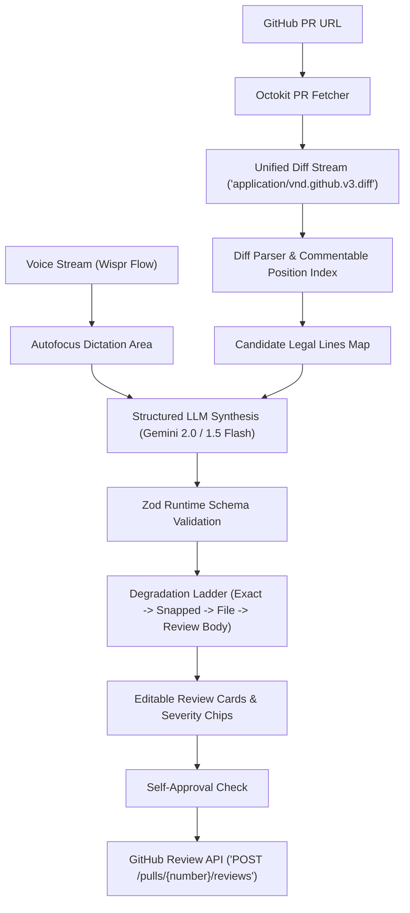

# Vox PR 🎙️

> **Transform spoken thought into GitHub pull request reviews grounded in real diffs.**

Vox PR solves the friction of code review: **Thinking about code is fast; writing down reviews is painfully slow.** When engineers spend minutes hunting down line numbers, toggling inline comment boxes, and fighting review interfaces, reviews become terse, constructive feedback is omitted, and bugs slip through.

With **Vox PR**, you paste a GitHub pull request URL, read the diff on screen, and dictate your thoughts naturally out loud (using system-wide dictation tools like **Wispr Flow** or the built-in browser mic fallback). Vox PR parses the pull request diff, computes legal commentable coordinates, grounds your spoken critique into exact diff lines, tags them with severity, formats suggested code replacements, and posts a review directly to GitHub.

---

## Key Features

- **Wispr Flow & System Dictation Native:** Prominent, autofocus text input designed for high-speed voice streaming.
- **Strict Diff Grounding:** Calculates legal `(path, line, side)` commentable tuples from the unified diff before LLM placement.
- **4-Tier Degradation Ladder:** Never loses a reviewer's thought:
  1. **Exact Anchor:** Anchored directly if the spoken line is in the diff hunk.
  2. **Nearest-Neighbor Snapped:** Snapped to closest legal diff line if slightly off (within 20 lines) with an explicit in-UI notice.
  3. **File-Level Comment:** Placed as a file-level note if line is beyond proximity threshold or on binary/deleted files.
  4. **Review Body Note:** Captured under `### Additional Review Notes` if the file is outside the PR.
- **Self-Approval Guard:** Automatically detects when the reviewer is the PR author and safely downgrades `APPROVE` to `COMMENT` to prevent GitHub API `HTTP 422` rejections.
- **Public Demo Sandbox & Rate Limiting:** Allows anonymous developers to test the live application on a designated public repository with IP rate limiting and abuse protection, while enabling authenticated users to review private repositories.
- **Zero Mock Data:** Every code path interacts with real GitHub APIs and real language model endpoints with strict runtime Zod validation.

---

## Architecture Flow



---

## Getting Started

### Prerequisites

- Node.js 18+ (tested on Node v20)
- npm or pnpm
- Google AI (Gemini) API Key (free tier available at [Google AI Studio](https://aistudio.google.com/))
- GitHub Personal Access Token (for reviewing private repositories or submitting reviews)

### 1. Installation

```bash
git clone https://github.com/napraveen/wispr-flow-demo.git
cd vox-pr
npm install
```

### 2. Environment Variables

Copy the example environment file and configure your keys:

```bash
cp .env.example .env.local
```

Edit `.env.local`:
```env
# Google AI (Gemini) API Key
GEMINI_API_KEY=your_gemini_api_key_here

# GitHub Token (Optional for public reads, required for posting reviews)
GITHUB_TOKEN=your_github_pat_here

# Public Demo Repository Coordinates
GITHUB_DEMO_REPO_OWNER=napraveen
GITHUB_DEMO_REPO_NAME=wispr-flow-demo
GITHUB_DEMO_PR_NUMBER=1

# App URL
NEXT_PUBLIC_APP_URL=http://localhost:3000
```

### 3. Run Development Server

```bash
npm run dev
```

Open [http://localhost:3000](http://localhost:3000) in your browser.

---

## Testing

Run the full automated test suite covering live GitHub PR fetching, diff parsing, edge-case diffs (renames, deletions, binaries, multi-hunks), structured output schemas, snapping degradation, review posting, and IP rate limiting:

```bash
npm test
```

---

## Production Build

```bash
npm run build
npm run start
```

---

## License

MIT License. See [LICENSE](file:///c:/Users/Natarajan/Desktop/Wispr%20Flow/LICENSE) for details.
